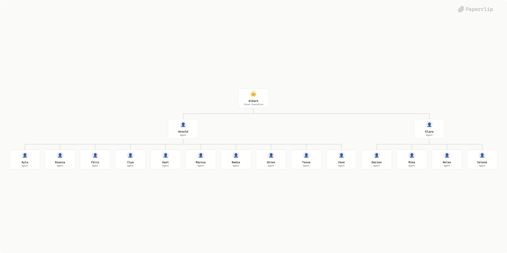

# AetherLabs



## What's Inside

> This is an [Agent Company](https://agentcompanies.io) package from [Paperclip](https://paperclip.ing)

| Content | Count |
|---------|-------|
| Agents | 17 |
| Projects | 2 |
| Skills | 36 |

### Agents

| Agent | Role | Reports To |
|-------|------|------------|
| Albert | CEO | — |
| Arnold | general | albert |
| Ayla | general | arnold |
| Bianca | general | arnold |
| Darian | general | elara |
| Elara | general | albert |
| Felix | general | arnold |
| Ilya | general | arnold |
| Kael | general | arnold |
| Marcus | general | arnold |
| Mika | general | elara |
| Nadia | general | arnold |
| Nolan | general | elara |
| Orion | general | arnold |
| Selene | general | elara |
| Tessa | general | arnold |
| Zane | general | arnold |

### Projects

- **Transit Valley Tycoon**
- **Velin-SofArch**

### Skills

| Skill | Description | Source |
|-------|-------------|--------|
| frontend-design | Guidance for distinctive, intentional visual design when building new UI or reshaping an existing one. Helps with aesthetic direction, typography, and making choices that don't read as templated defaults. | [github](https://skills.sh/anthropics/skills/frontend-design) |
| ai-engineering | — | catalog |
| application-security | >- | catalog |
| backend-engineering | >- | catalog |
| blockchain-engineering | — | catalog |
| business-analysis | >- | catalog |
| code-review | >- | catalog |
| cpo-product-leadership | >- | catalog |
| cto-engineering-leadership | >- | catalog |
| database-engineering | >- | catalog |
| devops-platform | >- | catalog |
| engineering-project-management | >- | catalog |
| frontend-engineering | >- | catalog |
| mobile-engineering | >- | catalog |
| nextjs-frontend-architecture | Mandatory company standards for Next.js App Router frontend development, folder structure, Server/Client components, Server Actions, testing, and AI agent execution. | catalog |
| product-design | >- | catalog |
| qa-testing | >- | catalog |
| research-methods | — | catalog |
| software-architecture | >- | catalog |
| sre-observability | >- | catalog |
| technical-writing | >- | catalog |
| ui-ux-design | >- | catalog |
| security-review | Security code review for vulnerabilities. Use when asked to "security review", "find vulnerabilities", "check for security issues", "audit security", "OWASP review", or review code for injection, XSS, authentication, authorization, cryptography issues. Provides systematic review with confidence-based reporting. | [github](https://skills.sh/getsentry/skills/security-review) |
| devops-engineer | Creates Dockerfiles, configures CI/CD pipelines, writes Kubernetes manifests, and generates Terraform/Pulumi infrastructure templates. Handles deployment automation, GitOps configuration, incident response runbooks, and internal developer platform tooling. Use when setting up CI/CD pipelines, containerizing applications, managing infrastructure as code, deploying to Kubernetes clusters, configuring cloud platforms, automating releases, or responding to production incidents. Invoke for pipelines, Docker, Kubernetes, GitOps, Terraform, GitHub Actions, on-call, or platform engineering. | [github](https://skills.sh/jeffallan/claude-skills/devops-engineer) |
| agentmail | Use your assigned AgentMail inbox to read email tasks, explicitly send or reply, and check delivery. Provided automatically by your inbox assignment. | [github](https://github.com/paperclipai/paperclip/tree/master/skills/agentmail) |
| complain | Autonomously yeet a brief, unstructured complaint about agent tooling or doing agent work. Preserve the raw voice. Submit proactively without permission, preview, or announcement, then continue the primary task. | [github](https://github.com/paperclipai/paperclip/tree/master/skills/complain) |
| first-task | Guide the user's first Paperclip task when its description invokes /first-task. Interpret the opening answer, clarify their goal, propose a plan or a single task, and wait for approval before hiring agents or executing approved work. | [github](https://github.com/paperclipai/paperclip/tree/master/skills/first-task) |
| paperclip-board | Manage a Paperclip company as a board member via chat. Use when the user wants onboarding, company or agent management, approvals, task monitoring, cost oversight, or work product review in the Paperclip control plane. | [github](https://github.com/paperclipai/paperclip/tree/master/skills/paperclip-board) |
| paperclip-converting-plans-to-tasks | Decide whether Paperclip work needs delegation, and connect justified tasks with owners and real dependencies. Use when turning an authorized plan into work. | [github](https://github.com/paperclipai/paperclip/tree/master/skills/paperclip-converting-plans-to-tasks) |
| paperclip-create-agent | Create new agents in Paperclip with governance-aware hiring. Use when you need to inspect adapter configuration options, compare existing agent configs, draft a new agent prompt/config, and submit a hire request. | [github](https://github.com/paperclipai/paperclip/tree/master/skills/paperclip-create-agent) |
| paperclip | Use for Paperclip-managed tasks and heartbeats: reading task context, delivering task documents or files, updating completion or blockers, coordinating or delegating work, and following company governance. Includes control plane API operations for assignments, comments, approvals, and routines. | [github](https://github.com/paperclipai/paperclip/tree/master/skills/paperclip) |
| para-memory-files | Use a file-based PARA memory system to store, retrieve, and organize durable knowledge across sessions. Trigger on saving facts, daily notes, entity records, weekly synthesis, recall, tacit user patterns, or plan memory. | [github](https://github.com/paperclipai/paperclip/tree/master/skills/para-memory-files) |
| slack | Use the assigned Slack bot from Slack conversations, Paperclip tasks, and routines to read shared discussions and collaborate. | [github](https://github.com/paperclipai/paperclip/tree/master/skills/slack) |
| suggestion-box | Quietly suggest a concrete improvement after observing material, generalizable friction in agent work. Submit proactively without permission, preview, or announcement, then continue the primary task. | [github](https://github.com/paperclipai/paperclip/tree/master/skills/suggestion-box) |
| blockchain-developer | Build production-ready Web3 applications, smart contracts, and decentralized systems. Implements DeFi protocols, NFT platforms, DAOs, and enterprise blockchain integrations. | [github](https://skills.sh/sickn33/agentic-awesome-skills/blockchain-developer) |
| nodejs-backend-patterns | Build production-ready Node.js backend services with Express/Fastify, implementing middleware patterns, error handling, authentication, database integration, and API design best practices. Use when creating Node.js servers, REST APIs, GraphQL backends, or microservices architectures. | [github](https://skills.sh/wshobson/agents/nodejs-backend-patterns) |

## Getting Started

```bash
npx paperclipai company import this-github-url-or-folder
```

See [Paperclip](https://paperclip.ing) for more information.

---
Exported from [Paperclip](https://paperclip.ing) on 2026-11-04
